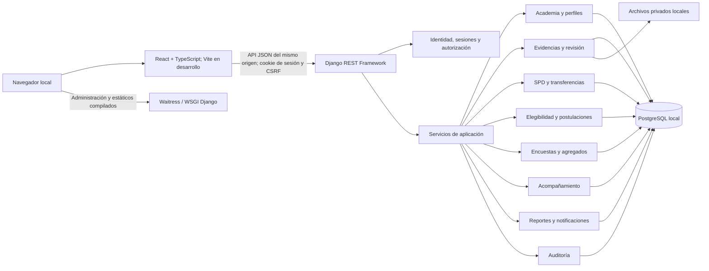
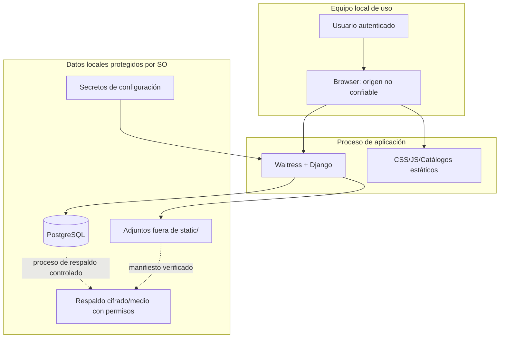

# E02 — Diseño integral de UPEA Talent+

**Versión:** 1.0 · **Fecha:** 9 de octubre de 2026  
**Depende de:** E01, [E01_ESPECIFICACION_FUNCIONAL.md](E01_ESPECIFICACION_FUNCIONAL.md)  
**Alcance:** diseño de datos, arquitectura, seguridad, navegación e interfaz para un producto local con soporte mult carrera.  
**Artefacto visual asociado:** [Prototipo navegable de baja fidelidad](prototipo/e02/index.html).  
**Estado:** entregable E02 preparado; diseño y prototipo no constituyen software productivo.

## 1. Resultado de E02

E02 define cómo se organizan los datos, módulos, permisos y pantallas a partir de los requisitos de E01. Entrega un modelo entidad-relación, diccionario lógico, arquitectura, modelo de amenazas, rutas por rol, guía visual y prototipo navegable.

El diseño base usa Django/PostgreSQL en local, interfaces responsivas con componentes propios, contexto explícito de carrera/periodo y una identidad académica sobria. La actualización de E05 mantiene Django/PostgreSQL y adopta React/TypeScript/Vite para el frontend y una API de sesión con Django REST Framework. El prototipo incluye datos ficticios y sirve para revisar jerarquía, términos y recorridos; no almacena registros ni verifica permisos reales.

## 2. Decisiones de diseño

| ID | Decisión | Justificación |
|---|---|---|
| DIS-01 | Monolito modular Django/PostgreSQL con frontend React separado por módulos y API del mismo origen | Conserva límites de dominio y controles de acceso en servidor, con una interfaz rica sin conectar el navegador a la base de datos. |
| DIS-02 | Una persona es cuenta, no rol; asignaciones dan rol y ámbito | Permite que un docente también sea estudiante u opere en varias carreras, sin multiplicar identidades. |
| DIS-03 | Carrera, periodo, grupo y matrícula son relaciones explícitas | Todas las consultas se limitan por contexto y se conservan cambios a través del tiempo. |
| DIS-04 | El sistema mantiene cuatro nociones visibles: mérito propio, puntos enviados, puntos recibidos y saldo transferible | Evita que transferencias se interpreten como rendimiento; no autoriza puntos negativos. |
| DIS-05 | Las decisiones importantes usan estados y registros versionados | El historial explica qué información y norma se aplicaron al actuar. |
| DIS-06 | Diseño claro, institucional y denso solo donde hay trabajo de coordinación | Separa tareas de estudiante del trabajo administrativo; reserva tablas para bandejas/reportes y tarjetas para resúmenes. |
| DIS-07 | Recursos propios locales, tipografía del sistema en el prototipo y paleta con tokens | El sistema seguirá legible y consistente sin CDN, fuente externa ni marca institucional no autorizada. |
| DIS-08 | El prototipo es presentacional y sin cuentas reales | Evita que el clic en un boceto se confunda con acciones persistidas o con seguridad ya implementada. |

## 3. Arquitectura lógica

### 3.1 Componentes y límites

El portal de usuario es una aplicación React empaquetada con Vite; en desarrollo Vite sirve el frontend y reenvía `/api/` a Django. La API JSON aplica sesión, token CSRF, ámbito, estado y reglas mediante los servicios existentes. En una compilación, los recursos se sirven localmente y PostgreSQL permanece accesible solo desde Django. Los módulos futuros seguirán este patrón; el panel administrativo Django queda para configuración técnica.

### 3.2 Responsabilidades de módulos

| Módulo | Responsable de | No debe hacer |
|---|---|---|
| `accounts` | Usuario, contraseña, sesión y asignaciones de rol/ámbito | Decidir acceso mirando solo el rol global de usuario. |
| `academics` | Institución, carrera, periodos, cursos, grupos, matrículas y datos oficiales importados manualmente | Permitir cambiar calificaciones desde la interfaz de perfil. |
| `profiles` | Perfil, habilidades, proyectos y logros declarados/validados | Guardar el saldo calculable como dato editable. |
| `activities` | Actividad, participantes, evidencia, adjuntos y revisión | Conceder puntos por llamada directa desde el navegador. |
| `points` | Reglas versionadas, cuentas derivadas, libro de movimientos y niveles | Sobrescribir saldos históricos o mezclar transferencias en mérito propio. |
| `opportunities` | Publicación/versiones, requisitos tipados, elegibilidad, solicitudes y decisión | Evaluar expresiones de código arbitrarias. |
| `transfers` | Solicitud, límites, aprobación, débito/crédito y casos de sospecha | Autorizarse a sí mismo o tratar puntos recibidos como transferibles. |
| `evaluations` | Campaña, cuestionario, habilitación, participación, respuestas y agregados | Exponer respuestas individuales en paneles/bitácora. |
| `support` | Indicador, alerta, seguimiento y acción de refuerzo | Aplicar sanciones, modificar notas o publicar listas de riesgo. |
| `reporting` | Consultas, resúmenes, CSV, impresión y bandeja de notificaciones | Saltarse la autorización de las consultas de origen. |
| `audit` | Eventos sensibles append-only a nivel de aplicación y búsqueda autorizada | Guardar secretos, archivos o contenido individual de encuesta. |

Los módulos pueden depender de servicios de dominio vecinos a través de interfaces Python internas. Se prohíben importaciones que formen ciclos; reglas y transacciones críticas no viven en vistas, plantillas o scripts JavaScript. Las notificaciones se emiten tras confirmar la transacción o mediante una tabla transaccional de eventos pendientes.

### 3.3 Entornos y límites de confianza

El navegador no es confiable aunque opere en la misma computadora: todos los identificadores, roles, valores de puntos, filtros y archivos enviados se consideran entrada manipulable. Un administrador del sistema operativo o de PostgreSQL puede inspeccionar datos; la bitácora de aplicación no garantiza resistencia ante ese nivel de acceso. La copia del disco y el acceso físico son responsabilidades operativas del equipo local.

## 4. Modelo entidad-relación

### 4.1 Diagrama conceptual

```mermaid
erDiagram
    INSTITUTION ||--o{ CAREER : contiene
    CAREER ||--o{ ACADEMIC_PERIOD : programa
    CAREER ||--o{ COURSE : ofrece
    CAREER ||--o{ ROLE_ASSIGNMENT : delega
    USER_ACCOUNT ||--o{ ROLE_ASSIGNMENT : recibe
    USER_ACCOUNT ||--o| STUDENT_PROFILE : posee
    CAREER ||--o{ ENROLLMENT : admite
    ACADEMIC_PERIOD ||--o{ ENROLLMENT : periodo
    STUDENT_PROFILE ||--o{ ENROLLMENT : matricula
    COURSE ||--o{ COURSE_OFFERING : instancia
    ACADEMIC_PERIOD ||--o{ COURSE_OFFERING : programa
    COURSE_OFFERING ||--o{ TEACHING_ASSIGNMENT : asigna
    USER_ACCOUNT ||--o{ TEACHING_ASSIGNMENT : participa
    ENROLLMENT ||--o{ GRADE_RECORD : registra
    COURSE_OFFERING ||--o{ GRADE_RECORD : evalua
    ENROLLMENT ||--o{ STUDENT_PROJECT : desarrolla
    ENROLLMENT ||--o{ STUDENT_SKILL : evidencia
    ACTIVITY ||--o{ ACTIVITY_PARTICIPATION : agrupa
    ENROLLMENT ||--o{ ACTIVITY_PARTICIPATION : participa
    ACTIVITY ||--o{ EVIDENCE : demuestra
    USER_ACCOUNT ||--o{ EVIDENCE_REVIEW : revisa
    EVIDENCE ||--o{ EVIDENCE_REVIEW : historial
    CAREER ||--o{ POINT_POLICY_VERSION : regula
    POINT_POLICY_VERSION ||--o{ POINT_RULE : define
    ENROLLMENT ||--o| POINT_ACCOUNT : mantiene
    POINT_RULE ||--o{ POINT_LEDGER_ENTRY : origina
    POINT_ACCOUNT ||--o{ POINT_LEDGER_ENTRY : acumula
    EVIDENCE ||--o{ POINT_LEDGER_ENTRY : acredita
    OPPORTUNITY ||--o{ OPPORTUNITY_VERSION : publica
    OPPORTUNITY_VERSION ||--o{ OPPORTUNITY_REQUIREMENT : exige
    OPPORTUNITY_VERSION ||--o{ ELIGIBILITY_SNAPSHOT : calcula
    ENROLLMENT ||--o{ ELIGIBILITY_SNAPSHOT : consulta
    OPPORTUNITY_VERSION ||--o{ APPLICATION : recibe
    ENROLLMENT ||--o{ APPLICATION : postula
    APPLICATION ||--o{ APPLICATION_DECISION : resuelve
    EVALUATION_CAMPAIGN ||--o{ EVALUATION_ELIGIBILITY : habilita
    ENROLLMENT ||--o{ EVALUATION_ELIGIBILITY : responde
    EVALUATION_ELIGIBILITY ||--o| EVALUATION_SUBMISSION : controla
    EVALUATION_SUBMISSION ||--|{ EVALUATION_ANSWER : contiene
    EVALUATION_CAMPAIGN ||--o{ EVALUATION_AGGREGATE : resume
    EVALUATION_CAMPAIGN ||--o{ SUPPORT_ALERT : detecta
    ENROLLMENT ||--o{ SUPPORT_ALERT : refiere
    SUPPORT_ALERT ||--o| SUPPORT_CASE : origina
    SUPPORT_CASE ||--o{ SUPPORT_ACTION : sigue
    TRANSFER_REQUEST ||--o| TRANSFER_REVIEW : decide
    TRANSFER_REQUEST ||--o{ POINT_LEDGER_ENTRY : contabiliza
    USER_ACCOUNT ||--o{ AUDIT_EVENT : actua
    USER_ACCOUNT ||--o{ NOTIFICATION : recibe
```

### 4.2 Principios de persistencia

- Claves primarias internas no se usarán como autorización; acciones sensibles cargan el objeto dentro de un queryset acotado al ámbito permitido.
- Claves foráneas con borrado protegido donde haya historial. Una persona retirada o una carrera cerrada se archiva/desactiva; relaciones históricas no desaparecen.
- Datos de puntos cambian solo mediante libro contable vinculado, restricciones e idempotencia. El saldo puede ser proyección reconstruible, nunca única fuente.
- Reglas, campañas, publicaciones y cuestionarios publicados son inmutables; editar genera versión nueva.
- Evaluación protege respuesta contra enlaces directos de identidad. La tabla de habilitación/participación registra quién ya respondió; la respuesta se almacena separada y el agregado no tiene IDs de estudiantes.
- Evidencia física se guarda fuera de carpeta pública; metadatos, hash, categoría, tamaño, nombre original saneado y clave aleatoria se registran en BD.
- Fechas de sistema se guardan con zona UTC; fechas académicas/mes de transferencias usan fechas/ventanas de `America/La_Paz`.

## 5. Diccionario lógico de datos

Los tipos están expresados como tipos Django/PostgreSQL lógicos (`UUID`, `varchar`, `text`, `boolean`, `date`, `timestamptz`, `integer`, `numeric`, `JSONB`). E02 no elige longitudes/índices definitivos; E03/E04 los formalizarán como migraciones. PK = clave primaria; FK = clave foránea; UQ = única; IDX = índice consultado con frecuencia. `created_at`/`updated_at` se añaden a entidades mutables salvo que se anote otra política. Campos de IDs y timestamps se omiten de filas por brevedad cuando son convencionales.

| Entidad | Campos lógicos principales | Claves/reglas de relación |
|---|---|---|
| `Institution` | `id UUID`, `name`, `short_name`, `timezone`, `active` | PK; única institución al inicio, soporta nombre y zona configurables. |
| `Career` | `id`, `institution_id`, `code`, `name`, `active` | FK institution; UQ `(institution_id, code)`. |
| `AcademicPeriod` | `id`, `career_id`, `code`, `name`, `start_date`, `end_date`, `grade_scale`, `pass_threshold`, `status` | FK career; UQ `(career_id, code)`; `start_date ≤ end_date`; escala/corte versionados antes de validar notas. |
| `Course` | `id`, `career_id`, `code`, `name`, `credits`, `active` | FK career; UQ `(career_id, code)`. |
| `CourseOffering` | `id`, `course_id`, `period_id`, `group_code`, `status` | FK course, period; UQ `(course_id, period_id, group_code)`. |
| `CourseEnrollment` | `id`, `enrollment_id`, `course_offering_id`, `active` | FK matrícula/oferta; UQ matrícula+oferta; relación refinada en E04 para aplicar permisos docentes a listas de grupo. |
| `UserAccount` | `id`, `email_normalized`, `password_hash`, `full_name`, `active`, `last_login_at` | email UQ; identidad no contiene rol ni carrera única. |
| `RoleAssignment` | `id`, `user_id`, `role_code`, `institution_id?`, `career_id?`, `group_id?`, `starts_at`, `ends_at`, `granted_by_id`, `reason`, `active` | FK user/grantor; ámbito no ambiguo; IDX `(user, role, scope, active)`. |
| `StudentProfile` | `id`, `user_id`, `student_number`, `privacy_preferences` | FK user UQ; student number UQ por institución, protegido. |
| `Enrollment` | `id`, `student_profile_id`, `career_id`, `period_id`, `semester_number?`, `status`, `valid_from`, `valid_to` | FK perfil/carrera/periodo; conserva historial y limita una activa equivalente. |
| `TeachingAssignment` | `id`, `course_offering_id`, `user_id`, `assignment_role`, `starts_at`, `ends_at` | FK oferta/cuenta; UQ por persona/oferta/rol vigente. |
| `GradeRecord` | `id`, `enrollment_id`, `course_offering_id`, `grade_value NUMERIC`, `scale_snapshot`, `pass_threshold_snapshot`, `status`, `source`, `verified_by_id`, `verified_at`, `supersedes_id?` | FK matrícula/oferta/verificador; una nota vigente por oferta/matrícula; corrección enlazada y conserva escala/corte de aprobación. |
| `StudentProject` | `id`, `enrollment_id`, `title`, `description`, `role`, `status`, `created_by_id`, `validated_by_id?`, `validated_at?`, `review_note?` | FK matrícula/declarante/validador; estados declarado/en revisión/validado/requiere cambios. |
| `StudentSkill` | `id`, `enrollment_id`, `skill_name`, `proficiency_label?`, `status`, `created_by_id`, `validated_by_id?`, `validated_at?`, `review_note?` | FK matrícula/declarante/validador; nivel es declaración hasta validación, sin rúbrica numérica asumida. |
| `PointPolicyVersion` | `id`, `career_id`, `version_no`, `status`, `valid_from`, `valid_to`, `approved_by_id?`, `published_at` | FK carrera; UQ `(career_id, version_no)`; versión publicada inmutable. |
| `PointRule` | `id`, `policy_version_id`, `category_code`, `description`, `base_points INTEGER`, `validation_criterion`, `transferable`, `requires_review`, `active` | FK versión; UQ categoría/versión; puntos enteros no negativos; define regla de acumulación. |
| `Activity` | `id`, `career_id`, `period_id?`, `activity_type`, `title`, `description`, `occurred_on`, `status`, `created_by_id` | FK carrera/periodo/actor; IDX por contexto y estado. |
| `ActivityParticipation` | `id`, `activity_id`, `enrollment_id`, `role`, `contribution_note?` | FK actividad/matrícula; UQ actividad+matrícula. |
| `Evidence` | `id`, `activity_id`, `submitted_by_id`, `storage_key`, `original_name_sanitized`, `media_type`, `byte_size`, `sha256`, `status`, `submitted_at`, `supersedes_id?` | FK actividad/actor/evidencia anterior; hash y clave no públicos. |
| `EvidenceReview` | `id`, `evidence_id`, `reviewer_id`, `decision`, `reason`, `criteria_snapshot`, `decided_at` | FK evidencia/revisor; historial append-only. |
| `PointAccount` | `id`, `enrollment_id`, `currency_code='SPD'`, `cached_merit_balance`, `cached_transfer_balance` | FK matrícula UQ; balances son proyecciones comparables con libro, no editables manualmente. |
| `PointLedgerEntry` | `id`, `account_id`, `entry_type`, `signed_amount INTEGER`, `policy_version_id?`, `point_rule_id?`, `activity_id?`, `evidence_id?`, `transfer_request_id?`, `idempotency_key`, `actor_id`, `reason`, `occurred_at`, `reversal_of_id?` | FK contexto; UQ clave idempotente; signo solo vía transacción validada, reversión enlaza original. |
| `Opportunity` | `id`, `career_id`, `owner_id`, `title`, `kind`, `status` | FK carrera/propietario; entidad de convocatoria con versiones. |
| `OpportunityVersion` | `id`, `opportunity_id`, `version_no`, `description`, `benefits`, `capacity`, `open_at`, `close_at`, `requirements_schema`, `published_at` | FK opportunity; UQ oportunidad/versión; contenido inmutable publicada. |
| `OpportunityRequirement` | `id`, `opportunity_version_id`, `field_code`, `operator`, `value_json`, `display_label`, `sort_order` | FK versión; operador/field allowlist, no código dinámico. |
| `EligibilitySnapshot` | `id`, `opportunity_version_id`, `enrollment_id`, `computed_at`, `overall_status`, `requirements_result_json`, `input_fingerprint` | FK versión/matrícula; conserva valor/fuente usados; no contiene secretos. |
| `Application` | `id`, `opportunity_version_id`, `enrollment_id`, `status`, `submitted_at`, `eligibility_snapshot_id`, `withdrawn_at?` | FK publicación, matrícula, evaluación; UQ una solicitud vigente por combinación. |
| `ApplicationDecision` | `id`, `application_id`, `actor_id`, `decision`, `reason`, `decided_at`, `supersedes_id?` | FK solicitud/actor; append-only y limitada por cupo dentro de transacción. |
| `TransferRequest` | `id`, `sender_enrollment_id`, `recipient_enrollment_id`, `amount`, `reason`, `activity_id`, `status`, `submitted_at`, `idempotency_key`, `risk_flags_json?` | FK matrículas/actividad; monto positivo; emisor≠receptor; clave UQ; indeleble tras resolución. |
| `TransferReview` | `id`, `transfer_request_id`, `reviewer_id`, `decision`, `reason`, `decided_at` | FK solicitud/revisor; revisor no puede ser partes. |
| `EvaluationCampaign` | `id`, `career_id`, `period_id`, `status`, `subject_type`, `questionnaire_version`, `minimum_responses`, `open_at`, `close_at`, `published_at` | FK carrera/periodo; mínimo congelado por versión/campaña. |
| `EvaluationEligibility` | `id`, `campaign_id`, `student_enrollment_id`, `subject_assignment_id`, `completion_status`, `answered_at` | FK grupo/persona asignada; UQ estudiante+asignación+campaña; sin puntuación/respuesta. |
| `EvaluationSubmission` | `id`, `campaign_id`, `subject_assignment_id`, `submitted_at`, `response_payload`, `response_bucket` | Clave aleatoria sin FK directa a estudiante; bucket controla tamaño mínimo/agregación. Separar privilegios/consulta de la tabla de participación. |
| `EvaluationAggregate` | `id`, `campaign_id`, `subject_assignment_id`, `questionnaire_version`, `response_count`, `metrics_json`, `suppression_state`, `published_at` | Sin identificador de respondiente; publicar solo al superar umbral y pruebas de intersección. |
| `SupportRuleVersion` | `id`, `career_id`, `version_no`, `indicator`, `threshold_json`, `valid_from`, `active` | FK carrera; predicados tipados y explicables. |
| `SupportAlert` | `id`, `rule_version_id`, `enrollment_id`, `period_id`, `evidence_snapshot`, `state`, `created_at`, `reviewed_by_id?` | FK contexto; guarda fuentes comparadas, acceso restringido, sin impacto en SPD/notas. |
| `SupportCase` | `id`, `alert_id`, `assigned_to_id`, `status`, `created_at`, `closed_at?`, `closure_reason?` | FK alerta/responsable; se puede descartar con motivo. |
| `SupportAction` | `id`, `case_id`, `action_type`, `description`, `due_on?`, `status`, `recorded_by_id`, `completed_at?` | FK caso/actor; tipos incluyen tutoría, asesoría, curso y recuperación. |
| `Notification` | `id`, `recipient_id`, `category`, `resource_type`, `resource_id`, `created_at`, `read_at?` | FK destinatario; URL no concede permisos; contenido mínimo. |
| `AuditEvent` | `id`, `actor_id?`, `role_context`, `scope_snapshot`, `action_code`, `object_type`, `object_id`, `reason?`, `result`, `occurred_at`, `correlation_id`, `safe_metadata_json` | Append-only aplicación; sin contraseña, token, cuerpo de respuesta o datos privados innecesarios. |

### 5.1 Restricciones de integridad que requieren pruebas de base

1. Una actividad aplicada a puntos queda idempotente por evidencia + regla + participante.
2. Un débito y un crédito de transferencia comparten ID de operación, se confirman juntos y suman cero en libro global.
3. El saldo transferible solo incluye créditos de origen elegible aún no gastados ni revertidos.
4. Límites de transferencia y saldo se verifican bajo bloqueo de cuenta o serialización para concurrencia.
5. Una nota vigente por matrícula y oferta; corrección enlaza a original y deja auditoría.
6. La cuota de postulaciones seleccionadas nunca supera la capacidad publicada.
7. No se publican agregados por combinaciones de filtros que reduzcan el conjunto efectivo debajo del umbral.
8. La eliminación en cascada queda inhabilitada en personas, reglas, movimientos, decisiones, respuestas y auditoría.

## 6. Diseño de navegación

### 6.1 Modelo de navegación

La cabecera persistente presenta marca tipográfica **UPEA Talent+**, carrera y periodo activos, búsqueda o ayuda contextual cuando exista, bandeja de notificaciones y menú de cuenta. El selector de carrera/periodo cambia el contexto seleccionado; cada servidor vuelve a autorizar el ámbito, no presupone acceso por selección.

En escritorio, navegación lateral principal con etiqueta y sección activa; el pie de página ofrece ayuda/versión. En móvil, navegación plegable con botón accesible y menú que no tape el foco. Migas de pan describen ubicación en informes y procesos de más de un paso. Ningún flujo depende de hover.

### 6.2 Mapa de páginas

| Área | Página | Ruta conceptual | Actor |
|---|---|---|---|
| Acceso | Ingreso / recuperación | `/acceso/`, `/recuperar/` | Todas las cuentas |
| Inicio | Resumen personal/carrera | `/inicio/` | Cambia según rol |
| Mi trayectoria | Perfil | `/estudiantes/{id}/trayectoria/` | Estudiante propio; otros solo asignados |
| Mi trayectoria | Académico y periodos | `/estudiantes/{id}/academico/` | Estudiante propio/docente asignado |
| Desarrollo | Proyectos y habilidades | `/estudiantes/{id}/desarrollo/` | Estudiante propio/docente asignado |
| Desarrollo | Actividades y evidencias | `/actividades/`, `/evidencias/` | Estudiante propio, revisor asignado |
| Reconocimiento | Movimientos SPD | `/spd/movimientos/` | Estudiante propio; administración limitada |
| Oportunidades | Listado y detalle | `/oportunidades/`, `/oportunidades/{slug}/` | Estudiante/coordinación |
| Oportunidades | Elegibilidad y mis postulaciones | `/oportunidades/{slug}/elegibilidad/`, `/postulaciones/` | Estudiante propio; responsable asignado |
| Colaboración | Transferir y recibir | `/transferencias/` | Estudiante propio/revisor independiente |
| Mejora | Evaluaciones académicas | `/evaluaciones/` | Respondiente habilitado/coordinación |
| Apoyo | Mi plan / casos asignados | `/acompanamiento/` | Estudiante propio/equipo asignado |
| Gestión | Revisión de evidencias | `/gestion/evidencias/` | Docente/revisor |
| Gestión | Oportunidades y postulaciones | `/gestion/oportunidades/` | Coordinación/responsable |
| Gestión | Campañas y agregados | `/gestion/evaluaciones/` | Coordinación; resultados protegidos |
| Gestión | Acompañamiento | `/gestion/acompanamiento/` | Coordinación/revisor asignado |
| Informes | Analítica e informes | `/informes/` | Coordinación/admin en ámbito |
| Administración | Personas, carreras y asignaciones | `/administracion/academia/` | Admin delegado |
| Administración | Reglas SPD y bitácora | `/administracion/reglamento/`, `/administracion/auditoria/` | Admin con permiso |

Las rutas son nombres conceptuales para navegación, no decisiones finales de URL/SEO. No exponen número estudiantil en slugs ni reemplazan los filtros de autorización.

### 6.3 Navegación por rol

| Estudiante | Docente/revisor | Coordinación | Administración |
|---|---|---|---|
| Inicio · Mi trayectoria · Actividades · Oportunidades · Transferencias · Evaluaciones · Acompañamiento · Avisos | Inicio · Mis grupos · Registrar actividad · Revisar evidencias · Progreso asignado · Avisos | Inicio de carrera · Oportunidades · Postulaciones · Evaluaciones · Acompañamiento · Informes · Auditoría autorizada | Inicio de administración · Personas y roles · Estructura académica · Reglas y parámetros · Oportunidades delegadas · Auditoría |

Cada usuario ve navegación calculada a partir de permisos activos. Los accesos directos, pestañas ocultas y URL ingresadas manualmente se vuelven a validar en servidor. Si hay más de un rol, menú de perfil permite cambiar de contexto; no se ejecuta una acción con rol oculto.

### 6.4 Flujos priorizados

**Estudiante obtiene mérito y postula:** Inicio → Mi trayectoria → registrar curso/proyecto → adjuntar evidencia → ver estado → notificación de aprobación → movimientos y nivel → Oportunidad → ver cada criterio (cumple/falta/dato insuficiente) → postular → consultar estado.

**Docente valida:** Inicio → seleccionar grupo asignado → revisar bandeja → abrir evidencia con historial → aprobar/observar/rechazar con criterio y motivo → confirmar operación → notificar estudiante.

**Coordinación decide beca:** seleccionar carrera/periodo → oportunidad/versiones → lista de elegibilidad explicada → revisar solicitudes y capacidad → decisión humana motivada → comunicar resolución y dejar rastro.

**Estudiante propone transferencia:** colaboración/proyecto → elegir otro estudiante habilitado → puntos transferibles disponibles y límites restantes → motivo/cantidad → resumen antes de enviar → estado pendiente → resultado y doble asiento.

**Acompañamiento:** panel de señales restringido → abrir comparación del estudiante consigo mismo → verificar datos/contexto → asignar recomendación o descartar motivadamente → registro de seguimiento → cierre del caso.

**Encuesta académica:** notificación → revisar propósito, criterio y escala → respuesta estructurada → confirmación → cierre de campaña → publicar solo agregado habilitado.

Los bocetos clicables están en `prototipo/e02/index.html` y pueden recorrerse sin conexión. Incluyen estudiante (trayectoria, evidencias, oportunidades, evaluaciones, acompañamiento y SPD), docente (bandeja de revisión), coordinación (indicadores agregados y apoyo) y administración (estructura y asignaciones). El selector cambia solo la navegación demostrativa; no autentica ni aplica permisos. Toda acción no conectada informa que no se guardó nada.

## 7. Guía visual y de interacción

### 7.1 Dirección visual

Identidad de producto académico público: clara, confiable, sobria y cercana. La interfaz prioriza jerarquía de información y lectura, no adornos ni competencia por rankings. Usar espacio blanco, superficies planas, bordes tenues, un color de acción principal y acentos con significado. No asumir ni redibujar logotipo UPEA; en prototipo se usa bloque tipográfico UPEA/“Talent+”.

UI/UX Pro Max dio como referencia una mezcla de teal educativo, acento ámbar y estilo plano. Adaptación propuesta: teal profundo para acciones, azul pizarra para navegación y tinta, marfil/gris casi blanco para fondo, ámbar para atención no crítica y estados semánticos con texto más símbolo. No se adoptó su combinación de fuentes Google porque rompería operación sin Internet; el prototipo usa familias de sistema. Esta no es una validación oficial de identidad institucional.

### 7.2 Tokens visuales (capas)

Valores base iniciales sujetos a medición de contraste durante implementación. Ningún componente debe introducir valor hexadecimal arbitrario.

| Capa | Token | Valor propuesto | Uso |
|---|---|---|---|
| Primitiva | `navy-900` | `#17324D` | Navegación y encabezados con texto blanco. |
| Primitiva | `teal-800` | `#176B63` | Acción primaria y selección activa. |
| Primitiva | `teal-050` | `#EAF4F2` | Superficie suave para información seleccionada. |
| Primitiva | `amber-800` | `#744800` | Texto/enlace de aviso no crítico sobre fondo claro. |
| Primitiva | `amber-050` | `#FFF5DF` | Fondo de pendiente/atención. |
| Primitiva | `ink-900` | `#182B3A` | Texto principal. |
| Primitiva | `ink-600` | `#526475` | Texto secundario. |
| Primitiva | `slate-100` | `#E7ECF0` | Bordes/controles deshabilitados. |
| Primitiva | `paper-050` | `#F5F7F8` | Fondo de página. |
| Primitiva | `paper-000` | `#FFFFFF` | Superficies de lectura. |
| Primitiva | `green-800` | `#256343` | Confirmación, con etiqueta junto al color. |
| Primitiva | `red-800` | `#9D3036` | Error/peligro con acción alternativa. |
| Semántica | `color-primary` | `var(--teal-800)` | Acción destacada. |
| Semántica | `color-text` | `var(--ink-900)` | Contenido. |
| Semántica | `color-muted` | `var(--ink-600)` | Texto auxiliar. |
| Semántica | `color-canvas` | `var(--paper-050)` | Fondo. |
| Semántica | `color-surface` | `var(--paper-000)` | Panel/tarjeta. |
| Semántica | `color-border` | `var(--slate-100)` | Separadores/control. |
| Semántica | `color-success/warning/danger` | verdes/ámbar/rojo | Estados + texto/icono; nunca solo color. |
| Primitiva | `space-1…8` | `4, 8, 12, 16, 20, 24, 32, 40 px` | Ritmo de separación. |
| Semántica | `space-component/section/page` | `12/24/32 px` | Componentes, grupos y páginas. |
| Primitiva | `radius-sm/md/lg` | `6/10/14 px` | Controles, paneles e indicadores. |
| Primitiva | `font-body/heading` | sistema sans-serif local | Legibilidad académica sin red. |
| Primitiva | `font-size-xs…3xl` | `12/14/16/20/24/32 px` | Escala; cuerpo de texto ≥16 px. |
| Primitiva | `line-height-body/title` | `1.5/1.2` | Lectura y títulos. |
| Semántica | `content-width` | máximo `1440 px` | Ancho en pantallas anchas; tablas de gestión aprovechan espacio. |
| Semántica | `z-nav/modal/notice` | `20/50/80` | Capas explícitas y consistentes. |
| Semántica | `motion-fast/normal` | `120/180 ms` | Color/opacidad; desactivar/reducir por preferencia. |

La paleta y los ratios se validarán en código con comprobación WCAG antes de marcar accesibilidad terminada. En particular se revisará texto sobre color primario y estados; token propuesto no equivale a ratio aprobado.

### 7.3 Componentes y estados

| Componente | Variantes y comportamiento |
|---|---|
| Botón | Primario (uno por vista), secundario, contorno, texto y peligro. Alto de referencia 40–44 px desktop y ≥44 px móvil; foco visible; inhabilitado con motivo accesible; al guardar, spinner y texto «Guardando…». |
| Campo | Etiqueta visible, requerido explícito, ayuda, error junto a campo y ejemplo realista; conservar valores y desplazar foco a primer error. |
| Estado | Texto «Aprobada», «Pendiente», «Observada», etc. más icono/estilo; leyenda disponible, no solo verde/rojo. |
| Panel | Título descriptivo, rango de fechas, valor/unidad, variación explicada y enlace a detalle si autorizado. |
| Tabla | Encabezados semánticos y orden de columnas estable; estado en columna propia; acciones con nombre; responsive mediante tarjetas/resumen o scroll accesible cuando tabla compleja no puede reflow. |
| Filtro | Etiqueta, opciones claras, aplicado visible, quitar filtros, estado reflejado en URL de páginas largas. |
| Alerta | Tipos información/éxito/atención/error; mensaje incluye consecuencia y siguiente acción; `role=status/alert` conforme a urgencia. |
| Diálogo | Solo confirmaciones puntuales; botón cancelar claro, foco atrapado/restaurado, Escape cuando corresponda; en móvil casi pantalla completa. |
| Navegación | Enlace para moverse; botón para acción. Estado actual `aria-current`; skip link; navegación por teclado, sin hover obligatorio. |
| Gráfica | Ejes/unidades/periodo y leyenda; equivalente tabular con el mismo contenido; patrones además de color y muestra pequeña/cero explicada. |
| Ayuda vacía | Explica qué debería aparecer y cómo empezar, con acción primaria específica y útil. |

### 7.4 Tipografía, iconografía y contenido

Usar fuente de sistema (`system-ui`, Segoe UI y sans-serif de respaldo), jerarquía medible, ancho de párrafo legible y números tabulares para puntos/columnas. Los iconos tendrán set vectorial local/licencia compatible en implementación; el prototipo usa símbolos tipográficos simples solo para baja fidelidad o etiquetas con texto. Sin emojis como sustituto de controles. Usar español claro, lenguaje respetuoso y fechas/formato Bolivia; escribir `100 puntos`, no asumir equivalencia a nota.

### 7.5 Layout y adaptación

Diseño de contenido primero con cortes de referencia 360, 768, 1024 y 1440 px. En escritorio: barra lateral de 240 px, cabecera contextual, contenido hasta 1440 px y grilla fluida. En móvil: paneles apilados, cabecera reducida, filtros en disclosure etiquetado, navegación plegable y acciones prioritarias visibles; nunca eliminar información crítica sin alternativa. Las tablas de administración pueden pasar a ficha de entidad o usar desplazamiento horizontal dentro de contenedor etiquetado, no en toda la página.

### 7.6 Accesibilidad y resiliencia

Objetivo WCAG 2.2 AA para recorridos prioritarios y verificación del criterio de aceptación RNF-07. Skip link, encabezados jerárquicos, HTML semántico, focus-visible, orden de foco, contraste normal 4.5:1/elementos no textuales 3:1, etiquetas programáticas, errores en línea, 200 % de zoom, teclado completo, `prefers-reduced-motion` y estado de interacción con alternativa. Formularios toleran nombres largos, valores ausentes, respuesta de error del servidor y guardado lento sin borrar el trabajo.

Antes de liberar HTML/CSS de producto, se revisará con la skill UI/UX Pro Max y se auditará el código contra [Vercel Web Interface Guidelines](https://github.com/vercel-labs/agent-skills/tree/main/skills/web-design-guidelines), recuperando el contenido vigente indicado por esa skill. No se confunde inspección automatizada con conformidad completa: también se verificará con teclado y tecnologías de asistencia si disponibles.

## 8. Modelo de amenazas

### 8.1 Activos, límites y adversarios

**Activos:** contraseña/sesión, identidad y matrícula, notas verificadas, adjuntos, movimientos de puntos, postulaciones y adjudicaciones, respuestas de evaluación, casos de apoyo, reglas/versiones, informes, auditoría, archivos de respaldo.

**Límites de confianza:** navegador→servidor; servidores→DB/archivos; roles entre carreras/grupos; tabla de habilitación→almacén de respuestas; archivos entrantes→descargas; respaldos→equipo externo/retención.

**Adversarios considerados:** usuario autenticado que intenta salir de su rol/ámbito, estudiante que trata de inflar puntos o cambiar su expediente, usuario malicioso que envía archivo/inyección, error administrativo, lectura incidental por usuario autorizado y pérdida/robo del equipo local. Administrador del SO/DB puede acceder a datos sin levantar una barrera criptográfica independiente; se registra como límite de confianza residual.

### 8.2 Riesgos STRIDE y controles

| ID | Riesgo | Impacto | Controles de diseño | Verificación en implementación |
|---|---|---|---|---|
| TH-01 Suplantación | Robo/reuso de contraseña o sesión | Alto: expediente, cuentas y decisiones | Hash fuerte con framework, sesión protegida, CSRF, rate limit, cierre/invalidez, recovery de un uso, cookies seguras si HTTPS. | sesión expirada, logout, ID de sesión fijado, contraseña errónea, recuperación repetida; no registro de secretos. |
| TH-02 Alteración | Forjar rol, carrera, destinatario, saldo, calificación, requisito o parámetro en cliente | Crítico | Rol/ámbito y cantidades resueltos en backend; lista de campos permitidos; invariantes transaccionales y auditoría. | modificar requests, IDs, amount, enum, JSON de requisito y estado en navegador; debe rechazar. |
| TH-03 Repudio | Usuario niega aprobación/transferencia/decisión | Alto | Eventos inmutables de aplicación con actor/rol/ámbito/fecha/motivo/resultado; correlation ID; movimientos compensatorios. | reconstruir escenario completo y actor efectivo; ajustar sin eliminar el origen. |
| TH-04 Divulgación | IDOR entre carreras, descarga pública, exportación, error/debug | Crítico | Queryset acotado, permiso por objeto, carpeta privada, exportación filtrada, mensajes no reveladores, debug off. | intentar cambiar IDs en detalle, historial, adjunto, CSV y búsqueda bajo todos los roles. |
| TH-05 Divulgación | Reidentificar respondientes en encuestas por muestra chica/intersección | Alto | Separación participación/respuesta, umbral, supresión complementaria, filtros no arbitrarios, sin texto libre. | combinaciones de periodo/grupo/asignatura, cinco+ respuestas y consultas solapadas; comprobar tamaño efectivo y permisos. |
| TH-06 Elevación | Usuario se autoasigna papel o revisa acción propia | Crítico | Denegar por defecto; asignaciones con responsable; separación de tareas y chequeo de conflicto de interés. | matrices por acción y casos propios/entre carreras/roles múltiples. |
| TH-07 Alteración | Doble recompensa por reintento o concurrencia | Alto | Clave idempotente/UQ, locks y transacción de revisión+libro, eventos de fuera de transacción idempotentes. | envío repetido, dobles clics y aprobaciones concurrentes. |
| TH-08 Alteración | Gastar saldo repetidamente, transferir puntos no transferibles o manipular límites | Alto | Saldo basado en movimientos, regla y origen rastreables, límites por ventana horaria Bolivia, bloqueo de fila, revisor imparcial. | transferencias simultáneas, ventanas de mes, reversión y cuenta sin origen disponible. |
| TH-09 Archivos peligrosos | Archivo ejecutable, HTML/SVG activo, traversal, MIME falseado o bomba de tamaño | Alto | Allowlist por extensión/contenido, tamaño/cantidad máximos, nombre interno, fuera de static, cabecera attachment/nosniff, no previews activos. | extensión/MIME cruzados, doble extensión, archivo grande, nombre traversal, acceso cruzado. |
| TH-10 Inyección/web | XSS persistente en nombre, descripción, exportación CSV injection, CSRF, SQLi | Alto | Escape contextual de plantillas, ORM, CSRF, sanitizar CSV fórmulas/control chars, CSP/cabeceras, formularios de mutación POST. | entradas con markup/quotes/fórmulas y llamadas cross-site; verificar texto inerte y token CSRF. |
| TH-11 Pérdida/alteración | Equipo robado, disco dañado o respaldo inconsistente | Alto | ACL del sistema, cifrado/medio de respaldo protegido cuando posible, copia coordinada y hashes, ensayo de restauración. | restaurar en entorno separado y contrastar movimientos/adjuntos. |
| TH-12 DoS/agotamiento | Cargas masivas, búsquedas sin límites, exportación gigante, CSV no paginado | Medio/alto | límites de petición y archivo, paginación, índices, límite de exportación, tareas lentas en backend y timeout. | medir volumen de referencia y peticiones límite; respuesta controlada. |
| TH-13 Divulgación | Exceso de datos en notificaciones, logs o errores | Alto | mensajes con datos mínimos, URLs re-autorizadas, logs sin payload sensible, páginas genéricas en producción. | revisar logs de flujos y notificaciones con datos sintéticos. |
| TH-14 Abuso de privilegio | Administrador de host lee DB/respuestas privadas | Alto residual | minimizar y separar datos, acceso de OS restringido, backups protegidos, registro de acciones administrativas externas según entorno. | documentar quién tiene cuenta del host/DB; no prometer anonimato frente a administrador técnico. |
| TH-15 Fallo de red/paquete remoto | CDN, font, servicio/API tercero indisponible/filtra visitas | Medio | todos los JS/CSS/iconos requeridos empacados localmente; fuente sistema; operación normal sin red. | cortar Internet y completar recorridos incluidos. |

### 8.3 Mitigaciones y riesgo aceptado

Los puntos de mayor prioridad para E04–E09 son aislamiento por ámbito (TH-04/06), integridad de libro y transferencia (TH-02/07/08), privacidad de evaluación (TH-05) y descarga privada (TH-09). Se verifican en las rutas, servicios y restricciones de DB, no se dejan a una lista visual.

El sistema local no cifrará por sí solo datos contra quien controla SO/DB. No se afirmará anonimato frente a una persona administradora que pueda inspeccionar ambos almacenamientos. El uso de datos reales debe esperar una decisión institucional de acceso, conservación, consentimiento/avisos, respaldo y revisión de campaña. Antes de eso, E03–E13 trabajan con información sintética.

## 9. Validación y aceptación de E02

| ID | Entregable | Aceptación de diseño |
|---|---|---|
| E02-D1 | Arquitectura | Se mantienen límites servidor, módulos y datos locales; ningún cálculo sensible confiado al cliente. |
| E02-D2 | Modelo ER | Cubren actores, asignaciones, carrera/periodo, actividad/evidencia, SPD, oportunidades, evaluación, apoyo, auditoría y archivos. |
| E02-D3 | Diccionario lógico | Cada entidad tiene atributos principales, claves y restricciones; se identifican decisiones por cerrar antes de migraciones. |
| E02-D4 | Navegación | Los flujos principales del E01 están descritos por rol y responden a selección de contexto y denegación. |
| E02-D5 | Sistema visual | Define identidad, tokens por capas, componentes, estados, respuestas y reglas responsivas/accesibles. |
| E02-D6 | Boceto navegable | Opera sin recursos externos, permite recorrer las cuatro perspectivas, muestra contexto y estados y declara que persistencia y autorización no están implementadas. |
| E02-D7 | Amenazas | Amenazas priorizadas tienen controles y verificación para las siguientes entregas; límites se comunican claramente. |

**Resultado de línea base:** los siete elementos están representados. El modelo es lógico y se refina al crear los modelos Django en E03/E04. El prototipo visual es un boceto sujeto a comentarios antes de usarlo como fuente de CSS productivo. No se incorpora todavía el software real, migraciones ni una auditoría del futuro producto.

## 10. Siguiente paso — E03

Al iniciar E03, utilizar estos artefactos para crear el esqueleto de Django, configuración PostgreSQL local, migraciones iniciales y recursos estáticos. Antes de materializar el esquema se cotejará cada campo del diccionario con los criterios del E01. Los campos dependientes de aprobación institucional se mantendrán configurables y los datos de arranque serán exclusivamente ficticios.

