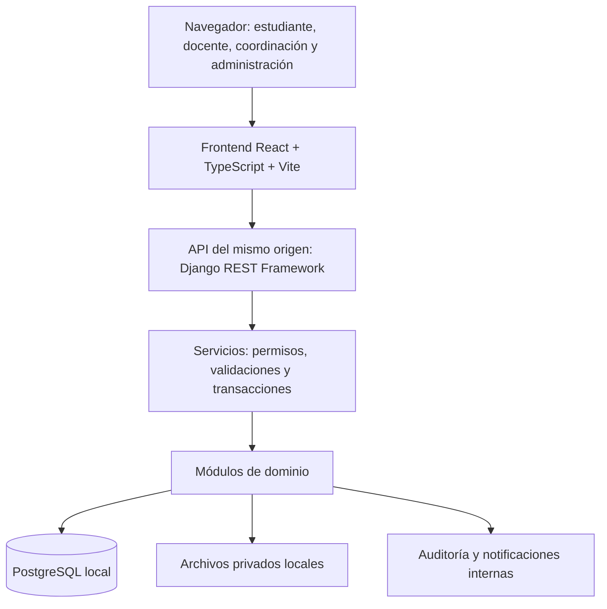

# UPEA Talent+ — Plan de desarrollo del producto completo

**Versión:** 1.1 · **Fecha:** 10 de octubre de 2026  
**Estado:** plan maestro actualizado; E01, E02 y E03 completados. El producto continúa en desarrollo incremental.  
**Documento de origen:** [UPEA_TALENT_Proyecto_Feria_Cientifica.md](UPEA_TALENT_Proyecto_Feria_Cientifica.md).  
**Responsable de implementación:** Codex, mediante entregas sucesivas en este proyecto.  
**Condiciones:** herramientas gratuitas, ejecución local, soporte para varias carreras y datos ficticios iniciales de Ingeniería de Sistemas.

## 1. Resultado esperado y límites del producto

Construir una aplicación web completa para administrar la trayectoria universitaria: antecedentes académicos, habilidades, proyectos, actividades, evidencias, puntos, oportunidades, evaluaciones y acompañamiento. El producto debe permitir que estudiantes, docentes, administradores y coordinación completen sus procesos con permisos, historial y resultados verificables.

La entrega final será una versión 1.0 instalable y operable localmente, con código fuente, base de datos mediante migraciones, interfaz terminada, datos de demostración, pruebas y documentación. Las etapas intermedias serán incrementos del mismo producto, sin sustituir las funciones finales por pantallas simuladas.

El calendario de feria del documento original no limita este plan. Las fechas del 13 y 16 de octubre no se presentan como compromiso de terminación del producto completo. El avance se medirá por entregables y criterios de aceptación.

### Alcance incluido

- Gestión de institución, carreras, periodos, asignaturas, grupos e inscripciones.
- Usuarios, roles con ámbito de carrera y asignaciones docentes.
- Perfil integral, trayectoria académica, proyectos, habilidades, cursos y logros.
- Actividades y evidencias con revisión, observaciones y resolución.
- Reglamento versionado, movimientos de puntos y niveles.
- Oportunidades, elegibilidad explicable, postulaciones y decisiones institucionales.
- Transferencias limitadas y supervisión de irregularidades.
- Evaluaciones de docentes y auxiliares con resultados agregados.
- Alertas, recomendaciones y seguimiento de acompañamiento.
- Administración, indicadores, reportes, notificaciones internas y auditoría.
- Instalación local, copias de seguridad, restauración y mantenimiento.

### Extensiones posteriores al producto local

Se conservan como evolución las integraciones con sistemas oficiales, correo/WhatsApp, aplicación móvil nativa, inteligencia artificial avanzada, firma digital e integraciones externas que el documento ubica en una segunda versión. Requieren acuerdos, servicios o datos que hoy no están disponibles. La aplicación contará con límites de módulos y servicios internos que permitan incorporarlas después. El cálculo de elegibilidad y las recomendaciones de la versión 1.0 usarán reglas explícitas.

## 2. Forma de trabajo y trazabilidad

Codex realizará análisis detallado, diseño, programación, migraciones, preparación de datos, pruebas, correcciones y documentación. El usuario podrá revisar las entregas y ajustar prioridades; las decisiones técnicas ordinarias se resolverán dentro de este plan. La aprobación de reglamentos institucionales corresponde a la universidad y no se presumirá por implementar datos ficticios.

Cada entrega seguirá esta secuencia:

1. Detallar historias de usuario y criterios de aceptación del módulo.
2. Registrar las decisiones de arquitectura o negocio que afecten a otros módulos.
3. Diseñar flujo, pantallas, permisos y cambios de datos.
4. Implementar el flujo completo con migraciones y datos reproducibles.
5. Verificar reglas, permisos, errores y experiencia de uso.
6. Actualizar documentación y matriz de trazabilidad; registrar defectos pendientes.

Cada requisito tendrá un identificador `RF` o `RNF`, su sección de origen, historias, reglas, pruebas y entrega responsable. Se mantendrá un backlog con estados: pendiente, en desarrollo, en revisión, terminado y bloqueado. Un cambio de alcance tendrá impacto documentado sobre datos, seguridad, interfaz y trabajo pendiente.

Se utilizará Git local con cambios pequeños y descriptivos, exclusión de secretos y archivos privados, y etiquetas para versiones aceptadas. No se necesita un repositorio remoto para operar. Los comandos de verificación podrán ejecutarse localmente y reutilizarse en integración continua si se añade posteriormente.

## 3. Decisiones técnicas

### 3.1 Arquitectura propuesta

Se implementará un **monolito modular**: una aplicación desplegable con módulos de dominio separados y una base de datos compartida. La interfaz invocará servicios que centralicen permisos, transacciones y reglas. No se duplicará el cálculo de puntos o elegibilidad en el navegador.



| Componente | Elección | Motivo y condición |
|---|---|---|
| Lenguaje y servidor de aplicación | Python compatible con Django 5.2 LTS | Ecosistema mantenible; fijar versión y parche compatibles al iniciar. |
| Framework | Django 5.2 LTS con parche de seguridad vigente | Autenticación, formularios, ORM, migraciones y protección CSRF integrados. La rama tiene soporte extendido anunciado hasta abril de 2028. |
| Base de datos | PostgreSQL local, versión estable soportada por Django | Restricciones y transacciones para validaciones, postulaciones y transferencias concurrentes. |
| Interfaz | React + TypeScript + Vite; estilos Tailwind CSS y componentes accesibles propios | Interfaz tipada, modular, adaptable y con recursos compilados localmente; no requiere CDN ni alojamiento de pago. |
| API | Django REST Framework y autenticación por sesión/CSRF del mismo origen | Mantiene consultas, reglas, autorización y transacciones bajo Django; React nunca recibe credenciales de PostgreSQL. |
| Interacción | Componentes React y formularios conectados a la API | Filtros y actualizaciones de estado sin duplicar reglas críticas en el navegador. |
| Gráficos | Librería local según el módulo, con tablas equivalentes | Evolución, participación y resultados agregados comprensibles y accesibles. |
| Archivos | Directorio privado fuera de los recursos públicos | Descarga mediada por permisos y metadatos en la base de datos. |
| Ejecución Windows | Entorno virtual Python y Waitress | Servidor WSGI compatible con Windows; recursos estáticos servidos mediante una solución local como WhiteNoise, a verificar al iniciar. |
| Calidad | Pruebas de Django/Python, cobertura, Ruff y Playwright | Reglas y transacciones en backend, estilo y recorridos reales en navegador. |
| Documentación | Markdown y Mermaid | Requisitos, diagramas, manuales y decisiones versionados con el código. |

Fuentes técnicas: [Django y soporte](https://www.djangoproject.com/download/), [Django REST Framework](https://www.django-rest-framework.org/), [React](https://react.dev/learn), [Vite](https://vite.dev/guide/), [Tailwind CSS](https://tailwindcss.com/docs), [licencia de PostgreSQL](https://www.postgresql.org/about/licence/), [Chart.js](https://www.chartjs.org/docs/latest/), [Waitress](https://docs.pylonsproject.org/projects/waitress/en/stable/) y [Playwright para Python](https://playwright.dev/python/docs/intro).

El documento original propone Flask/FastAPI y SQLite para cumplir el plazo del prototipo. Este plan cambia esa elección para el producto completo: Django reduce trabajo de infraestructura y PostgreSQL será la base de referencia desde el inicio. No se mantendrán implementaciones paralelas de SQLite y PostgreSQL.

La instalación inicial requerirá descargar dependencias Python y Node.js. Después, los flujos del sistema funcionarán sin Internet: el frontend compilado, sus bibliotecas, iconos y recursos se servirán localmente. No habrá dependencia de CDN, cuentas SaaS ni servicios de pago. Docker solo facilita PostgreSQL local; se puede usar una instalación local de PostgreSQL equivalente.

### 3.2 Organización del código

```text
config/                   Configuración por entorno y rutas
apps/
  accounts/               Usuarios, sesiones y asignación de roles
  academics/              Carreras, periodos, grupos y matrículas
  profiles/               Trayectoria, habilidades y proyectos
  activities/             Actividades, evidencias y revisiones
  points/                 Reglamento, movimientos y niveles
  opportunities/          Requisitos, elegibilidad y postulaciones
  transfers/              Solicitudes, límites y resolución
  evaluations/            Encuestas y agregados
  support/                Alertas y seguimiento
  reporting/              Indicadores y exportaciones
  audit/                  Eventos y consulta restringida
  notifications/          Bandeja interna
frontend/src/             React + TypeScript del portal
apps/<dominio>/api.py     API Django REST Framework por módulo
apps/<dominio>/static/    Recursos compilados servidos localmente
tests/                    Integración y recorridos completos
scripts/                  Instalación, inicio, respaldo y restauración
docs/                     Especificaciones, decisiones y manuales
package.json              Dependencias y scripts locales de frontend
```

Los archivos cargados, respaldos, secretos y registros de ejecución estarán fuera del control de versiones. Las dependencias tendrán versiones fijadas y un inventario de licencias. Las actualizaciones pasarán por revisión de compatibilidad y pruebas.

## 4. Organización académica y control de acceso

La institución contendrá varias carreras. Un usuario podrá tener varios roles, cada uno vinculado a una carrera o al ámbito institucional. La matrícula relacionará al estudiante con una carrera y un periodo; sus actividades y puntos conservarán ese contexto. Cambiar la carrera seleccionada en la interfaz no concederá permisos adicionales.

| Rol | Acciones permitidas | Límites principales |
|---|---|---|
| Estudiante | Consultar su trayectoria, enviar evidencias, postular, transferir y evaluar cuando corresponda | Acceso a sus propios registros y a información publicada; sin validar sus propias evidencias. |
| Docente | Registrar actividades, revisar evidencias asignadas y consultar progreso autorizado | Solo carreras, grupos y estudiantes asignados; sin edición general de saldos. |
| Administrador | Usuarios, configuración, reglas, oportunidades y auditoría | Facultades delimitadas por ámbito; operaciones sensibles con motivo e historial. |
| Coordinación | Oportunidades, reportes, resolución y acompañamiento | Acceso a las carreras asignadas; datos de evaluación exclusivamente agregados. |

Los auxiliares serán personas con asignaciones académicas y podrán ser sujetos de evaluación. Su acceso como revisores requerirá una asignación explícita; ser auxiliar no otorgará automáticamente permisos de docente.

La comprobación de permisos se aplicará en cada operación, consulta, descarga y exportación. Se probarán cruces entre carreras y accesos a identificadores ajenos. Los reportes institucionales requerirán permiso explícito.

## 5. Requisitos funcionales y aceptación

| ID | Módulo y funciones del producto | Evidencia mínima de aceptación |
|---|---|---|
| RF-01 | Cuentas: alta administrada, acceso, cierre de sesión, cambio y recuperación local de contraseña, activación/desactivación | Un usuario desactivado pierde acceso; recuperación mediante token temporal de un solo uso, con cambio obligatorio y registro de la operación. |
| RF-02 | Estructura académica: carreras, periodos, asignaturas, grupos, docentes, auxiliares y matrículas | Crear otra carrera sin modificar código; ningún coordinador accede a carreras no asignadas. |
| RF-03 | Perfil: información básica, historial académico, cursos, proyectos, habilidades, logros y progreso | Distinguir información declarada de validada; el estudiante no puede editar notas verificadas. |
| RF-04 | Actividades y evidencias: envío, revisión, observación, reenvío, aprobación y rechazo motivado | Una aprobación concede puntos una sola vez y permite consultar evidencia y revisor. |
| RF-05 | SPD: categorías, reglas versionadas, vigencia, movimientos, saldo y niveles | Reconstruir el saldo desde movimientos y explicar cada modificación. |
| RF-06 | Oportunidades: publicación, requisitos, fechas, carreras, cupos y estado | Una oportunidad vencida no recibe nuevas postulaciones; sus condiciones publicadas quedan versionadas. |
| RF-07 | Elegibilidad y postulaciones: comparación por requisito, envío, revisión, decisión y cierre | Mostrar cumple/no cumple/datos insuficientes; conservar evaluación usada y motivo de selección o rechazo. |
| RF-08 | Evaluaciones: campañas, cuestionarios, habilitación y agregación | Un estudiante habilitado responde una vez por asignación/campaña; no se muestran agregados bajo el umbral. |
| RF-09 | Acompañamiento: reglas de alerta, recomendaciones, responsable y seguimiento | Crear una alerta explicable, asignarla y cerrarla con resultado, sin penalización automática. |
| RF-10 | Transferencias: solicitud, motivo, validación, límites, consulta y reversión | La operación conserva el total de puntos entre las dos cuentas y resiste solicitudes simultáneas o repetidas. |
| RF-11 | Administración y auditoría: catálogos, revisiones, ajustes y bitácora | Registrar actor, ámbito, motivo y resultado de cada operación sensible. |
| RF-12 | Analítica y reportes: filtros por carrera/periodo, tendencias y exportación CSV e impresión | Gráficos y tablas coinciden con los datos; exportar respeta los mismos permisos. |
| RF-13 | Notificaciones internas: evidencias, postulaciones, transferencias y acompañamiento | El destinatario recibe un aviso con acceso autorizado al detalle y puede marcarlo como leído. |
| RF-14 | Operación local: instalación, datos iniciales, inicio, respaldo y restauración | Recuperar base de datos y archivos en un directorio/entorno limpio y repetir un recorrido completo. |

Las notificaciones internas, recuperación local, matrículas y campañas detallan capacidades de soporte necesarias para que los módulos del documento funcionen como producto completo.

## 6. Reglas de negocio

### 6.1 Definiciones conservadas del documento

| Actividad validada | Puntos |
|---|---:|
| Aprobar una materia | 10 |
| Mejorar rendimiento respecto al periodo anterior | 15 |
| Curso certificado | 10 |
| Seminario o conferencia | 5 |
| Proyecto académico | 20 |
| Proyecto destacado | 30 |
| Participación en investigación | 25 |
| Participación en concurso | 15 |
| Ganador de concurso | 40 |
| Colaboración validada | 5 |
| Mentoría a otro estudiante | 10 |

| Nivel | Puntos |
|---|---:|
| Explorador | 0–99 |
| Participante | 100–249 |
| Desarrollador | 250–499 |
| Líder | 500–749 |
| Talento destacado | 750 o más |

Cada asignación tendrá actividad, criterio, evidencia o validación y responsable. Las penalizaciones exigirán regla publicada y evidencia. Los puntos no modificarán notas oficiales. Los cambios sensibles quedarán registrados y las decisiones institucionales conservarán revisión humana.

Se reproducirá el ejemplo de beca: promedio mínimo 70, al menos 100 puntos de trayectoria, participación en un proyecto y curso de investigación aprobado. El detalle mostrará qué requisito se cumple y con qué registro se acredita.

### 6.2 Detalles necesarios para implementar

Las siguientes son **propuestas operativas configurables**, porque el documento no fija estos detalles. Los valores de demostración se etiquetarán como tales; no se presentarán como reglamento oficial aprobado.

| Tema | Política inicial propuesta |
|---|---|
| Ámbito de puntos | Cuenta por matrícula/carrera; la vista global agrupa trayectorias sin duplicar actividades ni mezclar reglas silenciosamente. |
| Mérito y transferencias | Mostrar puntos propios validados, recibidos, enviados y saldo. Nivel y requisito «puntos de trayectoria» usarán mérito propio vigente; las transferencias reconocerán colaboración sin convertir puntos recibidos en mérito académico. |
| Categorías transferibles | Solo colaboración validada y mentoría habilitadas inicialmente. Materias, investigación, cursos y premios no transferibles. Los puntos recibidos no se retransfieren. |
| Límites de demostración | Máximo 10 puntos por operación y 20 enviados por mes y cuenta; parámetros versionados. Solo misma carrera inicialmente, sin autoenvíos, cantidades negativas, cero ni fracciones. |
| Validación de transferencias | Requerir motivo y referencia de colaboración, y aprobación por revisor autorizado distinto de las partes. Comprobar saldo y límites nuevamente al aprobar. |
| Doble reconocimiento | Una evidencia/actividad no genera la misma recompensa dos veces. Proyecto destacado reemplaza el valor de proyecto académico para el mismo hecho; ganador reemplaza participación en el mismo concurso. Registrar solo la diferencia si ya se otorgó el valor menor. |
| Mejora de rendimiento | Comparar promedios de periodos cerrados comparables; una recompensa por periodo cuando el promedio aumenta. Sin periodo anterior o datos suficientes, no conceder automáticamente. |
| Promedio y aprobación | Usar historial validado, escala y criterio de aprobación configurables; documentar ponderación. La demostración usará datos sintéticos con promedio reproducible. |
| Evaluaciones | Publicación al cerrar campaña con mínimo inicial de 5 respuestas por agregado permitido. No habrá comentarios libres en la primera versión; los criterios serán estructurados. |
| Revisión de decisiones | Observaciones y solicitudes de revisión con responsable y resolución; nunca sobrescribir el historial de un rechazo, ajuste o selección. |
| Transparencia de puntos | El estudiante consulta saldo, movimiento, regla, evidencia, fecha y motivo; la interfaz explica cada concesión, ajuste y reversión. |
| Reglas nuevas | Vigencia explícita y sin recalcular el pasado automáticamente. Una corrección histórica requiere procedimiento de ajuste, explicación y evaluación de oportunidades afectadas. |
| Penalizaciones | Infraestructura disponible, catálogo inicialmente vacío; no descontar puntos por bajo rendimiento ni por responder encuestas. |

Estas políticas se registrarán como decisiones de dominio antes de implementarlas. Cambiar una política que altera el significado de puntos o elegibilidad exigirá actualizar ejemplos, migraciones necesarias y pruebas.

### 6.3 Integridad de puntos y estados

- Usar un libro de movimientos anexados: concesión, transferencia, ajuste y reversión. Una corrección crea un movimiento compensatorio; no borra el original.
- Cada movimiento referencia cuenta, categoría, regla/versionado, actividad u operación, actor y fecha. Una clave de idempotencia y restricciones únicas impiden recompensas duplicadas.
- La aprobación de evidencia, concesión y auditoría se guardan dentro de una transacción. Los avisos se generan después de confirmar o mediante una bandeja transaccional recuperable.
- La transferencia bloquea las cuentas en orden consistente, vuelve a verificar límites y disponibilidad, y registra débito/crédito atómicos. Conservar el origen de los puntos transferibles.
- Una anulación de mérito no falsificará los movimientos históricos. Si afecta puntos ya enviados, congelar nuevas transferencias de la cuenta y resolver la regularización mediante movimientos vinculados. El saldo disponible nunca podrá gastarse por debajo de cero.
- Las notas corregidas y evidencias revocadas disparan revisión de mérito y elegibilidad. Una adjudicación anterior conserva la decisión original y registra la revisión correspondiente.

Estados previstos:

| Entidad | Ciclo principal |
|---|---|
| Evidencia | Borrador → enviada → en revisión → observada → reenviada → aprobada/rechazada; revocación motivada posterior. |
| Oportunidad | Borrador → publicada → cerrada → resuelta → archivada; cancelación motivada. |
| Postulación | Enviada → en revisión → seleccionada/no seleccionada; retiro por estudiante antes de resolución. |
| Transferencia | Solicitada → aprobada/rechazada/cancelada; reversión administrativa vinculada. |
| Campaña de evaluación | Borrador → abierta → cerrada → agregados publicados si cumplen condiciones. |
| Acompañamiento | Detectado → revisado → asignado → en seguimiento → cerrado/descartado con motivo. |

### 6.4 Elegibilidad y decisiones

Los requisitos se construirán mediante campos tipados y operadores permitidos: carrera, periodo/semestre, promedio, puntos propios, actividad, habilidad y curso validado. No se ejecutará código ni expresiones arbitrarias introducidas por administradores.

Cada resultado guardará versión de requisitos, fecha de cálculo, valores considerados y explicación. Los datos faltantes producirán «datos insuficientes». La postulación fijará una evaluación histórica; al resolver se recalculará y señalarán diferencias. La selección humana tendrá cupo, responsable y motivo. Un cambio de requisitos publicados creará nueva versión y avisará a las personas afectadas; no cambiará silenciosamente una postulación anterior.

### 6.5 Evaluaciones y acompañamiento

La habilitación para evaluar se derivará de la matrícula y asignación académica. El registro de participación impedirá duplicados, separado de las respuestas sin clave directa al estudiante. No se guardará el contenido de respuestas en bitácoras ni se expondrán respuestas individuales desde el panel administrativo.

El formulario cubrirá los criterios del documento: claridad de enseñanza, organización, cumplimiento del contenido, calidad de la retroalimentación, puntualidad, atención a consultas e igualdad de trato percibida. Cada criterio tendrá escala, definición y periodo. El formulario no permitirá insultos ni comentarios ofensivos: en la primera versión no habrá campo de texto libre. El sistema presentará distribuciones y promedios agregados, no dictámenes; no emitirá automáticamente acusaciones de favoritismo. Resultados que ameriten atención podrán derivarse a revisión institucional con acceso restringido y trazabilidad.

No se promete anonimato absoluto frente a quien administra físicamente la base de datos: se minimizarán correlaciones temporales e identificadores, se restringirá el acceso técnico y se documentará esta limitación. Se impedirán filtros o combinaciones de reportes que revelen grupos pequeños; las cuentas institucionales recibirán agregados predefinidos, no consultas libres. Los agregados mostrarán cantidad de respuestas, escala y distribución.

Las alertas de acompañamiento usarán reglas configurables sobre progreso y participación, con evidencia, fecha y explicación. La falta de datos no se interpretará como bajo desempeño. Las recomendaciones serán tutorías, cursos o asesorías vinculadas al indicador; un responsable hará seguimiento. No se publicarán etiquetas de riesgo ni rankings personales.

## 7. Modelo de datos previsto

| Área | Entidades y relaciones principales |
|---|---|
| Identidad | Usuario, asignación de rol, ámbito de carrera, recuperación temporal y sesiones. |
| Academia | Institución → carrera → plan de estudios/asignatura; periodo, grupo, asignación docente/auxiliar, matrícula e historial de calificaciones. |
| Perfil | Perfil estudiantil, proyecto, participación, habilidad, acreditación y logro; vinculados a matrícula y evidencias. |
| Actividades | Tipo de actividad, actividad, participación, evidencia, versión de archivo y revisión. |
| Puntos | Reglamento, versión de regla, categoría, cuenta por matrícula, movimiento, origen transferible y reversión. |
| Oportunidades | Oportunidad, versión de requisitos, requisito tipado, evaluación de elegibilidad, postulación y decisión. |
| Transferencias | Solicitud, revisión, transferencia confirmada, movimientos pareados y controles de límite. |
| Evaluación | Campaña, cuestionario versionado, criterio, habilitación/participación, respuesta separada y agregado. |
| Acompañamiento | Regla de alerta, alerta, caso, responsable, acción de apoyo y seguimiento. |
| Operación | Notificación, evento de auditoría, parámetros versionados y registro de tareas de mantenimiento. |

Antes de migrar se elaborará el diagrama entidad-relación y el diccionario de datos: tipos, obligatoriedad, índices, claves, restricciones, acceso y conservación. Se decidirá explícitamente qué entidades se archivan y cuáles permiten eliminación física. Usuarios con historial se desactivarán; evidencias y decisiones conservarán trazabilidad según la política definida.

Se almacenarán fechas técnicas en UTC y se mostrarán en `America/La_Paz`. Las ventanas mensuales, fechas límite y cierres usarán esa zona. Los puntos serán enteros y promedios/umbrales decimales, evitando errores de coma flotante.

## 8. Diseño de experiencia e interfaz

### 8.1 Proceso y recursos

Se diseñarán primero los recorridos, luego bocetos de pantallas y finalmente componentes reutilizables dentro del proyecto. Los prototipos HTML/CSS locales servirán como recurso de diseño revisable, sin cuenta de diseño de pago. Bootstrap aportará componentes base; el aspecto final tendrá identidad propia, paleta sobria, tipografía legible y jerarquía académica.

Para apoyar esta labor, el proyecto incluye las skills **UI/UX Pro Max** (`.agents/skills/ui-ux-pro-max`) y **Vercel Web Design Guidelines** (`.agents/skills/web-design-guidelines`). UI/UX Pro Max ayudará a generar y contrastar propuestas para interfaces académicas y dashboards, y a buscar criterios sobre tipografía, gráficas, formularios, navegación y accesibilidad. Sus resultados serán material de diseño que se adapta a las necesidades reales de cada rol; no se aplicará una recomendación genérica si contradice los requisitos del producto. La skill de Vercel se usará como revisión adicional del código de interfaz y pide consultar sus pautas actuales en cada auditoría. Por el requisito local/sin Internet, cualquier sugerencia que dependa de fuentes, iconos, imágenes o CDN remoto se reemplazará por recursos con licencia adecuada servidos localmente o por alternativas del sistema.

Se creará una guía visual con colores, espaciado, tamaños, tipografía de sistema, iconos locales con licencia compatible, botones, formularios, tablas, avisos, tarjetas, estados y gráficos. El nombre de la institución será configurable; no se dará por autorizado un logotipo institucional no proporcionado.

### 8.2 Pantallas por contexto

| Contexto | Pantallas |
|---|---|
| Acceso | Inicio de sesión, recuperación, cambio de contraseña y sesión vencida. |
| Estudiante | Inicio, perfil, historial académico, habilidades/proyectos, evidencias, movimientos, oportunidades, postulaciones, transferencias, encuestas, acompañamiento y avisos. |
| Docente | Inicio, grupos, actividades, bandeja de revisión, detalle de evidencia y progreso autorizado. |
| Coordinación | Indicadores por carrera, oportunidades/postulantes, resultados agregados, casos de apoyo y reportes. |
| Administración | Usuarios/roles, estructura académica, reglamentos, revisiones sensibles, parámetros y auditoría. |

La navegación mostrará carrera y periodo activos. Cada pantalla contemplará carga, vacío, éxito, error, validación, falta de permisos y datos insuficientes. Habrá filtros, paginación, confirmaciones para operaciones sensibles y mensajes que expliquen el siguiente paso.

### 8.3 Accesibilidad y calidad visual

Objetivo: aplicar los criterios pertinentes de [WCAG 2.2 nivel AA](https://www.w3.org/TR/WCAG22/) y registrar evidencia de revisión. Se verificará teclado, foco visible, etiquetas, contraste, mensajes de error asociados, adaptación a ampliación y ausencia de dependencia exclusiva del color. Los gráficos tendrán texto/tablas equivalentes y los componentes dinámicos anunciarán cambios relevantes.

Se revisarán pantallas a 360, 768 y 1366 píxeles, tablas extensas, nombres largos y contenido vacío. La revisión combinará herramientas automáticas, navegación manual y capturas de los recorridos principales. Se evitarán rankings públicos y patrones visuales que confundan mérito propio con puntos recibidos.

## 9. Seguridad, privacidad y operación responsable

| Área | Implementación y verificación |
|---|---|
| Autenticación | Contraseñas mediante hash del framework; límites de intentos, expiración de sesión, cierre efectivo y mensajes que no revelen cuentas existentes. |
| Autorización | Denegar por defecto; comprobar rol, ámbito y propiedad en servidor para consultas y mutaciones, incluidos archivos y exportaciones. |
| Peticiones y contenido | CSRF en mutaciones, escape de salida, ORM parametrizado, validación en servidor y métodos HTTP correctos. |
| Evidencias | Lista inicial PDF/JPEG/PNG, máximo propuesto de 10 MB por archivo, verificación de contenido y extensión, nombre generado y almacenamiento privado. Rechazar ejecutables, HTML/SVG y rutas manipuladas. |
| Descargas | Comprobar permisos, servir adjuntos con cabeceras restrictivas; ningún archivo se ejecutará ni publicará como recurso estático. Los límites reducen riesgo pero no equivalen a análisis antivirus. |
| Datos | Perfil privado por defecto; minimización de datos personales; acceso de acompañamiento restringido y exportaciones auditadas. |
| Secretos | Configuración fuera del repositorio, ejemplo sin credenciales, permisos del sistema de archivos y cambio de claves de demostración al crear un entorno nuevo. |
| Registros | Errores técnicos sin contraseñas, tokens o respuestas de encuestas; auditoría de negocio separada y consulta restringida. |
| Entornos | Separar desarrollo, prueba, demostración y operación local. Modo depuración desactivado en operación; datos sintéticos identificados. |
| Dependencias | Versiones fijadas, revisión de avisos de seguridad, inventario de licencias y actualización controlada. |

El servicio se enlazará a `127.0.0.1` por defecto. Habilitar acceso desde la red local será una configuración documentada adicional con HTTPS, hosts permitidos y reglas de firewall apropiadas. Las cookies seguras dependerán del perfil HTTPS; no se expondrá la configuración de desarrollo a la red.

La auditoría será inmutable desde la aplicación, pero no se describirá como inviolable ante un administrador del equipo. Se registrarán accesos sensibles, cambios de reglas, revisiones, movimientos y exportaciones; las respuestas individuales de encuestas quedarán excluidas. Se definirán plazos de conservación y eliminación antes de utilizar datos reales.

Referencias de implementación: [autorización OWASP](https://cheatsheetseries.owasp.org/Authorization_Cheat_Sheet.html) y [carga de archivos OWASP](https://cheatsheetseries.owasp.org/File_Upload_Cheat_Sheet.html). Se mantendrá un modelo de amenazas enfocado en suplantación, acceso entre carreras, puntos duplicados, archivos peligrosos y reidentificación en evaluaciones.

## 10. Requisitos de calidad y pruebas

Los objetivos siguientes son criterios de aceptación propuestos; deberán medirse, no asumirse cumplidos por elegir una tecnología.

| ID | Objetivo | Verificación |
|---|---|---|
| RNF-01 | Integridad: cero duplicados o transferencias parciales en escenarios críticos | Restricciones y pruebas transaccionales/concurrentes sobre PostgreSQL. |
| RNF-02 | Aislamiento por carrera y propiedad | Matriz completa de permisos positivos y negativos por acción sensible. |
| RNF-03 | Rendimiento local | Objetivo inicial p95 ≤ 2 s en consultas habituales y ≤ 5 s en elegibilidad individual, con 20 sesiones concurrentes sobre equipo de referencia de al menos 8 GB RAM/SSD; registrar CPU, SO, volumen y resultados. |
| RNF-04 | Volumen de referencia | Dataset sintético de carga: 5.000 estudiantes y 100.000 movimientos, separado del dataset de demostración. Ajustar índices y consultas con medición. |
| RNF-05 | Accesibilidad | Criterios AA aplicables revisados y sin bloqueos de teclado en recorridos principales. |
| RNF-06 | Uso sin Internet | Completar los recorridos con red externa desconectada después de instalar dependencias. |
| RNF-07 | Recuperación | Restauración íntegra comprobada; objetivo inicial de pérdida máxima de 24 h con respaldo diario y recuperación en 60 min sobre el volumen de referencia. |
| RNF-08 | Mantenibilidad | Módulos delimitados, reglas centralizadas, migraciones reproducibles, verificaciones de estilo y documentación actualizada. |
| RNF-09 | Observabilidad | Errores y tareas identificables, página de salud restringida, bitácora filtrable y diagnóstico sin secretos. |

### Estrategia de verificación

- **Unitarias:** puntos, niveles, requisitos, fechas, límites, promedios y reglas de acompañamiento. Cubrir fronteras 99/100, 249/250, 499/500 y 749/750.
- **Integración:** persistencia, permisos, archivos, auditoría, cambios de estado y notificaciones. Ejecutar sobre la misma tecnología de base de datos del producto.
- **Concurrencia:** doble aprobación, doble clic, repetición de solicitud, dos transferencias sobre el mismo saldo y cupos de oportunidad.
- **Navegador:** recorridos por rol con Playwright; incluir fallos y recuperación de formularios, además de los casos exitosos.
- **Seguridad:** referencias a objetos ajenos, cruces entre carreras, sesión vencida, CSRF, archivos no permitidos y exportaciones sin permiso.
- **Privacidad:** mínimo de respuestas, filtros que reduzcan grupos, permisos sobre agregados y ausencia de respuestas en logs.
- **Visuales y accesibilidad:** revisión manual y automatizada de pantallas relevantes.
- **Operación:** instalación desde cero, actualización con migraciones, copia/restauración y funcionamiento sin Internet.

Se buscará al menos 85 % de cobertura en servicios de dominio críticos, acompañada de una lista explícita de invariantes comprobados. El porcentaje no reemplaza las pruebas de concurrencia, permisos o recorridos. Los hallazgos tendrán severidad, reproducción y resolución; no se liberará la versión 1.0 con defectos críticos o altos abiertos.

## 11. Datos ficticios y escenarios de aceptación

La carga de demostración será reproducible y separada de los datos operativos. Incluirá Ingeniería de Sistemas, tres periodos académicos, aproximadamente 30 estudiantes, 5 docentes, 2 auxiliares, coordinación y administración; actividades de todas las categorías, al menos 6 oportunidades, campañas y casos de acompañamiento.

Los nombres, correos y evidencias se identificarán como ficticios; los correos usarán dominios reservados de ejemplo. Un segundo conjunto de prueba con otra carrera validará el aislamiento sin presentar esa carrera como implantación real. Los comandos para regenerar demostraciones se restringirán a ese entorno.

Escenarios obligatorios:

1. Estudiante con 90 puntos propios registra un curso, recibe aprobación, alcanza 100 y cambia de nivel.
2. La misma solicitud de aprobación repetida conserva una sola recompensa.
3. Beca del documento: se muestra el cumplimiento de los cuatro requisitos y la postulación queda trazada.
4. Perfil con datos insuficientes recibe una explicación y no una elegibilidad inventada.
5. Transferencia de colaboración válida registra dos movimientos; superar límite o saldo se rechaza.
6. Dos transferencias concurrentes no gastan dos veces los mismos puntos.
7. Cuatro respuestas no publican resultados; cinco permiten el agregado autorizado al cierre.
8. Coordinación revisa y resuelve una alerta de acompañamiento con seguimiento.
9. Cuenta de otra carrera no obtiene expedientes, archivos ni reportes ajenos.
10. Revocar evidencia produce ajuste trazable y revisión de elegibilidad afectada.
11. Actualizar una regla no modifica el historial de puntos otorgados con la versión anterior.
12. Restaurar un respaldo conserva usuarios, evidencias, movimientos, decisiones y auditoría.

## 12. Plan de ejecución por entregas

Las entregas se implementarán en orden de dependencia. La interfaz, las pruebas y la documentación forman parte de cada entrega. El tamaño expresa complejidad relativa: M = media; A = alta. No representa días ni una promesa de fecha.

| Entrega | Dependencia | Trabajo y artefactos | Criterio de salida | Tamaño |
|---|---|---|---|---|
| E01 — Especificación | Este plan | [E01_ESPECIFICACION_FUNCIONAL.md](E01_ESPECIFICACION_FUNCIONAL.md): backlog RF/RNF, historias, matriz de permisos, reglas propuestas, estados y decisiones registradas | Los flujos quedan verificables; parámetros no aprobados se identifican y no se confunden con políticas oficiales. | M |
| E02 — Diseño integral | E01 | [Diseño integral](E02_DISENO_INTEGRAL.md), modelo ER, diccionario, arquitectura, amenazas, navegación, tokens y [prototipo navegable sin conexión](prototipo/e02/index.html) para cuatro roles; UI/UX Pro Max y revisión Vercel | Requisitos trazables, privacidad y ejemplos coherentes; prototipo accesible y claramente no persistente. | A |
| E03 — Base ejecutable | E02 | [Estructura Django](config/settings.py), [PostgreSQL local](compose.yaml), [dependencias bloqueadas](requirements-lock.txt), migración inicial, endpoints de salud y [guía de instalación](README.md) | Migraciones aplicadas en PostgreSQL 17; check, consistencia de migraciones, pruebas y endpoints live/ready verificados localmente. | M |
| E04 — Identidad y academia | E03 | [Modelos académicos, roles/ámbitos, servicios de autorización, auditoría básica, catálogo sintético y pruebas](E04_IDENTIDAD_ACADEMIA.md) | Inicio de sesión/estado de cuenta y aislamiento por carrera/grupo verificados; migraciones aplicables en PostgreSQL local. | A |
| E05 — Trayectoria | E04 | [Portal autenticado, perfil/historial verificable, proyectos y habilidades con flujo de revisión, componentes visuales comunes y dataset ficticio](E05_TRAYECTORIA.md) | Consultar y declarar según permisos; revisar solo grupos asignados; notas e historial preservan origen, verificador y correcciones. | M |
| E06 — Evidencias y SPD | E05 | Actividades, archivos privados, revisión, reglamento versionado, libro de movimientos y niveles | Curso → aprobación → puntos → nivel, sin duplicados y con reversión. | A |
| E07 — Oportunidades | E06 | Editor de requisitos, publicaciones, elegibilidad, postulaciones, cupos y resolución | Beca del documento funciona de extremo a extremo con explicación histórica. | A |
| E08 — Transferencias | E06 | Saldos disponibles por origen, límites, revisión, movimientos pareados y alertas de irregularidad | Pruebas de idempotencia, límites y concurrencia superadas. | A |
| E09 — Evaluaciones | E04, E05 | Campañas, cuestionarios, habilitación, participación separada y agregados | Un voto autorizado y publicación con umbral sin exposición individual. | A |
| E10 — Acompañamiento | E06, E07 | Reglas de alerta, sugerencias, casos, responsables y seguimiento | Alerta explicable y caso completo con acceso restringido. | M |
| E11 — Gestión y análisis | E07–E10 | Paneles por rol, reportes, filtros, exportaciones, notificaciones y consultas de auditoría | Indicadores correctos; permisos consistentes en todos los canales. | A |
| E12 — Consolidación | E11 | Recorridos integrales, seguridad, accesibilidad, rendimiento, consistencia visual y correcciones | Criterios RF/RNF medidos; defectos críticos/altos resueltos. | A |
| E13 — Operación y entrega | E12 | Instalador/scripts, respaldo/restauración, manuales, dataset, guion y versión etiquetada | Instalación limpia y recuperación demostradas; checklist de producto completo. | M |

E07, E08 y E09 tienen dependencias parcialmente independientes; eso permite cambiar el orden sin rediseñar el producto. El desarrollo previsto será secuencial por Codex. Al cerrar cada entrega se informará qué funciona, cómo se verificó y qué sigue. Si el trabajo continúa en otra sesión, el backlog y las decisiones guardadas serán el punto de continuidad.

No se estima una fecha final con precisión antes de comprobar el entorno y cerrar E01–E03. Al terminar E03 se podrá elaborar una previsión basada en complejidad restante y avance observado, actualizándola ante cambios de alcance.

## 13. Instalación, respaldo y mantenimiento

- **Entorno:** Windows local como destino inicial; comprobar versiones y recursos disponibles antes de instalar. Recursos objetivo de desarrollo: 8 GB RAM como referencia inicial, 16 GB preferibles y espacio SSD para evidencias y respaldos; medir consumo real.
- **Instalación:** scripts PowerShell para comprobar requisitos, crear entorno, instalar versiones fijadas, configurar conexión, migrar y crear administrador mediante entrada segura. No incluir contraseñas reales en scripts.
- **Inicio:** comando documentado para Waitress, archivos estáticos preparados y comprobación de salud. El servidor de desarrollo se reservará para desarrollo.
- **Mantenimiento programado:** comandos idempotentes para cerrar oportunidades, generar alertas, limpiar tokens y respaldar; ejecución manual o mediante Programador de tareas de Windows.
- **Respaldo coherente:** pausar escrituras durante la copia de base de datos y archivos, generar manifiesto con versión y hashes, y registrar resultado. Conservar inicialmente 7 copias diarias y 4 semanales, configurable.
- **Protección:** restringir acceso a respaldos y disponer de una copia en otro medio para cubrir fallo del disco; una copia en el mismo disco solo cubre ciertos errores operativos.
- **Restauración:** comprobar integridad, restaurar base y archivos, aplicar la versión compatible y verificar saldos, evidencias y acceso. El ensayo usará un entorno separado.
- **Actualización:** respaldo previo, migraciones verificadas, notas de versión y procedimiento de reversión. Si una migración no es reversible, recuperar el respaldo compatible; no asumir que basta con volver al código anterior.
- **Seguimiento:** revisar errores, espacio de almacenamiento, fallos de tareas, respaldos y dependencias. Documentar cómo diagnosticar problemas de conexión, permisos y archivos faltantes.

## 14. Riesgos y decisiones de control

| Riesgo | Respuesta prevista |
|---|---|
| Reglas incompletas o cambiantes | Catálogo versionado, decisiones explícitas y ejemplos automatizados antes de programar. |
| Transferencias utilizadas para inflar mérito | Separación visible entre mérito y transferencias, origen no retransmisible, límites y revisión. |
| Duplicación por reintentos o concurrencia | Idempotencia, restricciones únicas, transacciones y bloqueo de cuentas. |
| Acceso a otra carrera | Permisos de servidor por ámbito y pruebas negativas en consultas, archivos y exportaciones. |
| Identificación de evaluadores | Respuestas separadas, agregados limitados, umbral y revisión de combinaciones de filtros. |
| Datos académicos inconsistentes | Validación, fuente/versionado, periodos cerrados y correcciones trazables. |
| Pérdida de información local | Copias coherentes, medio adicional y ensayos de restauración. |
| Crecimiento de archivos y consultas | Límites, paginación, índices medidos y política de conservación. |
| Exceso de alcance | Backlog vinculado a RF/RNF; extensiones externas documentadas como evolución. |
| Apariencia terminada con procesos incompletos | Aceptación mediante recorridos completos, incluyendo rechazos, correcciones y recuperación. |

## 15. Documentación y criterio de producto terminado

Se entregarán:

1. Código fuente organizado, dependencias fijadas y migraciones.
2. Especificación funcional, historias y matriz de trazabilidad.
3. Arquitectura, decisiones, diagrama ER, diccionario de datos y estados.
4. Guía visual y componentes reutilizables.
5. Reglamento de demostración, ejemplos y explicación de elegibilidad.
6. Modelo de permisos, amenazas y tratamiento de evaluaciones.
7. Pruebas automatizadas, instrucciones de ejecución y resultados de aceptación.
8. Datos ficticios reproducibles y guion de demostración.
9. Manuales por rol y guía de instalación, operación, actualización y restauración.
10. Notas de versión, incidencias conocidas e inventario de licencias.

Una funcionalidad se considerará terminada cuando sus criterios de aceptación estén satisfechos, tenga controles de acceso, maneje errores y datos vacíos, registre las acciones sensibles, cuente con pruebas pertinentes y tenga documentación actualizada.

La **versión 1.0 completa** requerirá que RF-01 a RF-14 estén implementados, que los RNF tengan resultados registrados y desviaciones resueltas o justificadas, que no existan defectos críticos/altos abiertos y que se haya demostrado instalación y restauración. La operación con datos reales requerirá posteriormente validar reglas, autorizaciones y conservación con la institución; esa adopción no se confundirá con la terminación técnica del producto local.

## 16. Recorrido de demostración para la feria

La demostración contará un solo caso con perfiles ficticios y estados preparados de antemano. Tendrá una ruta de reserva documentada por si se interrumpe la red o falla una carga. Duración sugerida: 8–10 minutos.

1. Iniciar sesión como estudiante de Ingeniería de Sistemas y mostrar su perfil, progreso individual, logros y 90 puntos propios.
2. Enviar evidencia de un curso certificado; cambiar al docente asignado para revisar, observar si falta información y finalmente aprobar.
3. Regresar al perfil y enseñar la nueva concesión de 10 puntos con su motivo, regla y evidencia; verificar el nivel Participante al alcanzar 100.
4. Abrir la Beca de Investigación y mostrar los cuatro requisitos del documento, qué datos los acreditan y el resultado elegible. Registrar la postulación con su versión de condiciones.
5. Ingresar como coordinación, revisar la postulación y dejar una decisión humana motivada, conservando el resultado previo de elegibilidad.
6. Solicitar una transferencia limitada de 10 puntos por colaboración de proyecto; mostrar motivo, revisión requerida, resultado y movimientos pareados.
7. Mostrar una campaña de evaluación docente con criterios estructurados y luego el resultado agregado únicamente al superar el mínimo de respuestas; explicar que no identifica respuestas individuales.
8. Abrir una alerta de progreso académico, mostrar su comparación del estudiante consigo mismo, asignar tutoría y registrar una actividad de recuperación.
9. Cambiar a administración y mostrar indicadores de participación, oportunidad y trayectoria, junto con la bitácora de las acciones sensibles.
10. Cerrar mostrando carreras configurables y el acceso denegado al intentar consultar un expediente de otra carrera.

El relato sigue la frase conceptual del documento: reconocer lo que la persona aprendió, construyó y aportó, y explicar cómo alcanza oportunidades. Las cuentas de feria tendrán información ficticia, y el guion indicará cualquier resultado preparado o simulado.

## 17. Trazabilidad con el documento de origen

Esta matriz hace verificable la correspondencia entre las 20 secciones del proyecto original y el plan de producto completo.

| Sección original | Cobertura en este plan | Verificación/observación |
|---|---|---|
| 1. Resumen del proyecto | §§ 1, 5–8 | Perfil integral, puntos, habilidades, evidencias, oportunidades y seguimiento. |
| 2. Problema identificado | §§ 1, 5, 6.5, 10 | Datos dispersos, logros no académicos, trazabilidad y apoyo preventivo; cobertura por trayectoria e indicadores. |
| 3. Propuesta de solución | §§ 1, 5, 6, 7, 9 | Sistema integrado; automatiza comprobaciones, conserva decisión humana. |
| 4. Objetivo general | §§ 1, 5, 10, 15 | Plataforma completa y producto local aceptado por criterios. |
| 5. Objetivos específicos | §§ 5–10, 12 | Perfil, reglas, elegibilidad, evaluación agregada, alertas y auditoría, en entregas identificadas. |
| 6. Justificación | §§ 3, 8, 15 | Tecnología y decisiones documentadas; conserva el recorrido demostrable de actividad a oportunidad. |
| 7. Innovación y aporte | §§ 5–9, 16 | Perfil, validación, transparencia, privacidad, apoyo y trazabilidad. |
| 8. Usuarios y roles | § 4 | Estudiante, docente, administración y coordinación con ámbitos de carrera; auxiliares también pueden ser evaluados. |
| 9. Módulos principales | §§ 5, 7, 12 | Los diez módulos (incluidos dashboard, analítica y panel de administración) se desarrollan mediante RF y entregas. |
| 10. Puntos y reglamento | § 6.1–6.3 | Los 11 valores, los 5 niveles, reglas de control y movimientos quedan explicitados. |
| 11. Becas y oportunidades | §§ 5, 6.4, 11, 16 | Requisitos previos, comparación, explicación, historial y revisión humana; ejemplo íntegro. |
| 12. Evaluación docente/auxiliar | § 6.5, RF-08, §§ 11 y 16 | Los 7 criterios, formularios estructurados, umbral, resultados agregados y prohibición de acusación automática. |
| 13. Acompañamiento | RF-09, § 6.5, escenarios 8 y 16 | Indicadores académicos/de participación, progreso individual, tutoría y seguimiento de recuperación. |
| 14. Transferencia de puntos | §§ 6.2–6.3, RF-10, escenarios 5–6 y 16 | Motivo, límite mensual, categorías restringidas, revisión de sospechas y no modificación de requisitos oficiales. |
| 15. Arquitectura tecnológica | § 3 | Mantiene solución gratuita y local; Django/PostgreSQL se eligen para el producto completo y se documenta el cambio desde el prototipo Flask/SQLite. |
| 16. Modelo básico de datos | § 7 | Cubre usuario, estudiante, actividad, evidencia, habilidad, oportunidad, postulación, evaluación, transferencia y auditoría. |
| 17. Flujo para el jurado | § 16 | Se convierte en un guion de extremo a extremo con cambios de rol, transferencia, evaluación, estadísticas y bitácora. |
| 18. Alcance del prototipo | § 1, RF-01–RF-14, §§ 12 y 15 | El prototipo pasa a ser subconjunto temprano del producto; todas las funciones imprescindibles siguen incluidas. Integraciones y funciones de segunda versión quedan como extensiones. |
| 19. Cronograma 6–16 de octubre | §§ 1 y 12 | El calendario de prototipo/feria se conserva como hito de demostración; no se usa para prometer el producto completo. Las entregas se rigen por criterios verificables y no por fechas ficticias. |
| 20. Conclusiones y frase sugerida | §§ 1, 16 | La frase orienta el relato de demostración y la misión del producto. |

### Relación con el calendario de feria

El documento de origen programa un prototipo para el 13 de octubre de 2026, preparación los días 14–15 y presentación el 16. Este plan cubre el **producto completo**, que es el alcance indicado por el usuario, y no atribuye a esas fechas la terminación de las 13 entregas. La feria es un hito de presentación del subconjunto estable disponible. Para anunciar ese subconjunto se verificará con antelación que existan, como mínimo, datos ficticios, guion repetible y los recorridos que se presenten realmente; no se afirmará que funciones pendientes están implementadas. La versión 1.0 conserva el criterio final de § 15.

## 18. Próximo trabajo de implementación

E01 está documentado en [E01_ESPECIFICACION_FUNCIONAL.md](E01_ESPECIFICACION_FUNCIONAL.md) y E02 en [E02_DISENO_INTEGRAL.md](E02_DISENO_INTEGRAL.md), con un [prototipo navegable local](prototipo/e02/index.html). E03 preparó Django/PostgreSQL y su [guía reproducible](README.md); E04 dejó identidad, academia, permisos por ámbito y auditoría en [E04](E04_IDENTIDAD_ACADEMIA.md). E05 incorpora [portal autenticado de trayectoria, notas verificadas, proyectos/habilidades y revisión docente](E05_TRAYECTORIA.md). El siguiente trabajo es E06: evidencias y SPD. No se cargará información académica real sin aprobación institucional y configuración de los controles correspondientes.

